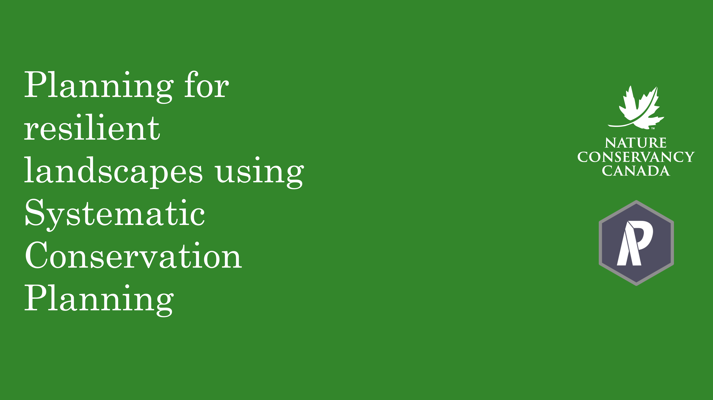
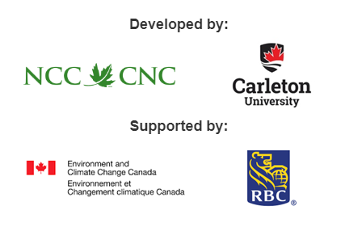

# Where to Work

[Where to Work](https://ncc.carleton.ca/) is a web-based application
for\
solving complex conservation scenarios using concepts\
of systematic conservation planning.

Where to Work provides a user friendly interface\
for developing conservation scenarios.\
It utilizes the [prioritizr](https://prioritizr.net/index.html) R
package to quickly\
find the best conservation solutions.

\

\

